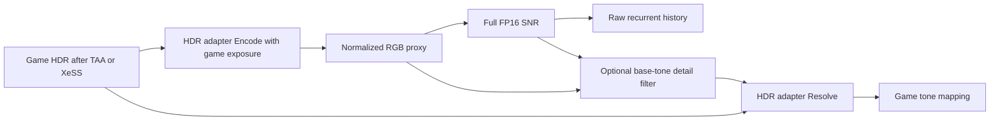

# Tekken: preserve base colour and lighting with the HDR adapter

**Status: rejected by the user and disabled on 2026-11-05.** It suppressed
intended neural colour/lighting and was not a demonstrated root-cause fix.
Tekken and Fast Food Simulator now have `PreserveBaseTone=false`,
`ColourStrength=1.0`, `TransferStrength=1.0`. The implementation remains opt-in
and inactive. The deployment/test record below is historical, not the current
recommended configuration. See SNR's
`model_tools/openvino_backend/native/COLOUR_INVESTIGATION_20261105.md`.

Subsequently both games' DLLs were restored from their pre-filter backups,
not just disabled by configuration. Both restored OpenVINO packages passed
40 GPU frames including temporal history. The source experiment below remains
for provenance; it is absent from the restored game binaries.

Implemented and installed on 2026-11-05. The preceding Fast Food Simulator
policy was restricted to finished SDR frames. Tekken's current installation
uses native **TAA → SNR → game tone mapping**, without XeSS, with engine motion
vectors. Applying an SDR filter directly to its scene-linear HDR would be wrong.

## Integration

The existing HDR adapter supplies normalized display-encoded `Adapter::Proxy()`
to every neural call. Enable the same provider presentation flag for that input:

`ValheimNr_Dx11::Session::ProcessSharedFrame` now permits `PreserveBaseTone`
for the external HDR path. The provider still receives colour/transfer
strengths of 1 there; `Adapter::Resolve` owns those controls and applies them
once. In particular, configured ColourStrength=0 preserves source HDR
chromaticity in the existing adapter. The raw model reconstruction enters
history before filtering. Exposure, motion, depth, model graph, weights and
padding are unchanged.

All Tekken flows use this common proxy contract, including native TAA→SNR,
SNR→XeSS and XeSS→SNR. The user's currently selected native mode was retained.
The filter was tested on a saved 1920×1080 HDR resource from the earlier XeSS
capture; that is a test input, not a claim that XeSS is enabled now.

UI: **Preserve base colour and lighting**. INI: `[DlssNr] PreserveBaseTone=true`.
Default remains false globally; it is enabled in this Tekken installation.
The live log reports `D3D11 NR presentation: preserve_base_tone=true
domain=HDR proxy before resolve`. The option can be switched without rebuilding
the graph; turning it off restores the complete model presentation.

## Validation on Arc Pro B70

- Extended `tests/nr-hdr-adapter/smoke.cpp` to replay full two-dimensional
  captured images and captured exposure using `--encode` and `--resolve`.
  Staging readback respects D3D11 row pitch. The existing unit cases still run.
- D3D11 debug layer: no warnings/errors. CPU sRGB/soft-knee reference, captured
  exposure, neutral HDR reconstruction, exact disabled/transfer-zero bypass,
  source hue and alpha checks passed.
- Actual saved HDR → adapter proxy → full SNR for 40 repeated frames with
  zero external motion → adapter resolve, both filter off and on: passed.
  Output is finite/nonnegative; alpha remains exact. Maximum HDR RGB is 11.38,
  so HDR values are retained above 1 rather than treated as SDR/clipped.
  Maximum normalized HDR chromaticity error with filtering is 0.0002224.
- The independent NumPy Gaussian reference differs from filtered GPU output
  by max 0.0009765625, mean 0.00003770. Investigated rather than silently accepting
  the original one-step threshold: two **unfiltered** full-model replays already
  differ by max 0.0009765625, mean 0.00003009. Filtering error is within the
  observed input-variation bound for `I-G` (norm ≤2) plus FP16 rounding.
  This 1080p full-model test is not claimed bitwise deterministic. Isolated
  filter tests from the preceding implementation cover exact constant removal,
  analytical impulse/edge response and independent history.

Warm medians, frames 5–39, 1920×1080 input / 1920×1088 model padding:

| Scope | Off | On |
| --- | ---: | ---: |
| Full model | 41.182 ms | 41.172 ms |
| Compose including filter | 0.416 ms | 0.876 ms |
| Provider total | 44.883 ms | 45.326 ms |

Added provider latency is about 0.44 ms in this offline replay. This is not game
frame time, and does not validate moving fighters/faces. Live quality remains
to be checked by the user. Filtering deliberately suppresses broad model
relighting; it does not repair/retrain the learned model and can retain local
brightness differences or spatial ringing.

## Deployment

Installed with Tekken closed and SHA-256 verification:

- `dxgi.dll`: `C2B0A9A611A439E42281404B406BECDF91490B5EA43413DB5EC3068913824F70`
- `snr_openvino/arc_nr_openvino.dll`: `4F8D65CA12DBEEA7C426B84F56F65F1F3E1F8A14BEAAA0D577A002F53D058F6A`
- INI: `PreserveBaseTone=true`; other settings and pipeline markers retained.

Local evidence and previous DLL/INI backups:
`K:\Codex\SNR-OptiScaler\work\tekken-openvino-colour-20261105\`.
`validation.json`, `installation.json`, `hdr-*.log`, `neural-*.log`, input/output
FP16 captures, `proxy-comparison.jpg`, and `before-patch/` are retained.
The comparison image shows normalized proxies, not the game's final tone-mapped
display. The Fast Food Simulator installed DLLs were not replaced by this step.
