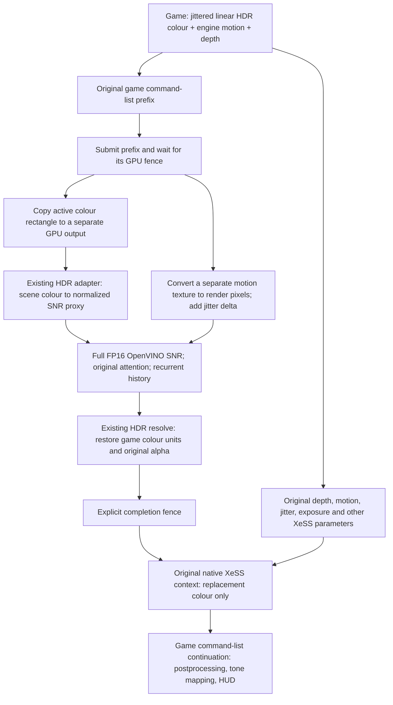

# Native D3D12 SNR в†’ XeSS

Status, 2026-11-05: **full OpenVINO SNR в†’ native XeSS passed the live
Witcher scene check without forced D3D12 validation**. The user confirmed:
“Движется, картинка нормальная” (moving, image looks normal). The log confirms
full FP16 inference and recurrent history. This is confirmation of the tested
scene, not exhaustive validation of every motion/disocclusion case or other games.
The temporary mode override has been removed; the normal default is full SNR.
The later memory/submission optimization passed standalone A/B tests and is installed;
its live log confirms full-model inference and temporal history. The user also
confirmed that the optimized build worked and then closed the game. The tested
input remained 1130Г—636 with 1920Г—1080 output; no 1280Г—720 live retest was recorded.

Installed OptiScaler SHA256 (pipeline-speedup build; live test confirmed by the user):
`327B6B9E9705A2902C95A794708EC55DEC51701EFFDD602D82ED0A43B14A24CB`.
The original XeSS SDK and full FP16 SNR provider are unchanged. Forced Windows
validation and its game marker have been removed; D3DConfig is app-controlled
with no application rules.

### Command-list freeze cause and repair

The original splice installed hooks using a command list created by OptiScaler.
Witcher's actual list exposed different implementations for 38 tracked methods,
including drawing, dispatch and state setters. These calls bypassed routing and
remained in the producer prefix instead of the continuation after XeSS. The
debug-layer wrappers masked this implementation mismatch, which explains why
the boundary worked with validation but froze/repeated the scene without it.

The splice now discovers each actual command-list implementation, installs its
missing entry points and waits for a fresh Reset before allowing a split. State
replay and forwarding use the destination list's own implementation. Hook
installation enrolls the process threads in the Detours transaction. Up to eight
implementations are supported; missing state coverage keeps the native path.
The live log confirms the 38 newly tracked methods and the user confirmed motion
in the same release-driver configuration that previously failed.

A separate regression also exposed legal RTV/DSV descriptor reuse: replaying a
raw CPU descriptor handle could bind a different texture. The continuation now
snapshots those descriptors at bind time. That fix alone did not resolve the
game freeze; both repairs are retained. Microsoft documents the lifetime in
[Descriptors overview](https://learn.microsoft.com/en-us/windows/win32/direct3d12/descriptors-overview).

## Data flow

The application still calls its own XeSS SDK, with its own quality selection,
resolution queries, exposure settings and context. No NGX translation is used.
Only the colour resource and its base change after successful SNR scheduling.
History resets are added when the visible SNR edit is enabled or disabled, or
after a processing discontinuity. Original game colour is never overwritten.

All production image transfers remain on the GPU. CPU readback is confined to
explicit diagnostic capture/tests. The boundary retains synchronous producer and completion fences. The native
processor now batches fallback/encode/input copies and output-copy/HDR resolve
into two submissions instead of four. External game-prefix/tail waits still exist.

## Modules

| Module | Responsibility |
|---|---|
| `inputs/XeSS_Native_Dx12` | Preserve the real SDK context and API queries; native execution and diagnostic capture |
| `inputs/XeSS_Nr_Dx12` | Validate the queried contract, schedule pre-XeSS SNR, snapshot controls/resources, publish UI status/timings |
| `dlssnr/sycl/D3D12CommandSplice` | Record/replay command-list state; split producer and continuation at the real API boundary; explicit submission fences |
| `dlssnr/sycl/XeSSNrInputContract` | Pure exposure and motion/jitter coordinate conversions |
| `dlssnr/sycl/XeSSNrInputAdapter` | GPU rectangle copy, original HDR encode/resolve, separate RG32F motion conversion |
| `dlssnr/sycl/XeSSNrProcessor` | One model/history per context; asynchronous preparation; owned D3D12 work; reset/fallback handling |
| `dlssnr/sycl/ArcNrSyclOwnedListBridge` | Shared GPU heaps and synchronous provider boundary, without host pixel staging |
| `SNR/model_tools/openvino_backend/native/provider_proxy.cpp` | Load the full OpenVINO provider and package dependencies; preload Intel math by absolute path |
| `tests/xess-nr-input` | Independent adapter tests, captured-frame processor tests, full proxy/SDK integration driver |

The new adapter uses the same validated SM5 shader bytecode as the existing D3D11
HDR adapter; D3D12 supports it. It does not use the independently generated older
D3D12 shader header. No model-colour suppression or source-base-tone filter is
enabled. Both transfer and colour strengths are 1 in the installed package.

## Input contract and current scope

The first enabled path accepts RGBA16F colour and RG16F/RG32F low-resolution
engine motion, with scalar exposure and simultaneous-access resources. Bases and
active rectangles are checked. Autoexposure, exposure-texture mode, high-resolution
motion, incompatible resource formats/states and unsupported command-list scopes
stay on the original XeSS path. This is not support for every D3D12 game.

After the prefix submission, eligible game resources decay to COMMON. Resources
touched by SNR are restored to COMMON, and the continuation reads the separately
produced colour. Depth is neither read nor modified by this SNR provider and is
forwarded to XeSS unchanged. Unsupported open queries, render passes, split
barriers, bundles and certain newer command-list state changes reject splitting.

For NDC motion, the SNR pixel scale is
`velocityScale * (inputWidth / 2, -inputHeight / 2)`. Pre-XeSS colour is jittered:
unless `JITTERED_MV` is set, current-to-previous motion adds
`previousGeometryJitter - currentGeometryJitter`, after the SDK's jitter scale.
The original motion texture and jitter still reach XeSS unchanged. History state
is advanced at actual submission, not just command recording. The model's frame
index also determines its noise features and must match in numerical A/B tests.

Scalar HDR normalization uses `whitePoint = 1 / (exposureScale * multiplier)`.
Supplying a texture pointer alone does not select XeSS's exposure-texture mode.
The model's normalized proxy is restored into the game's original HDR units
before XeSS and game tone mapping. This is the existing HDR transfer algorithm,
not a claim of an exactly invertible tone curve.

Model compilation runs on a worker. Original game rendering continues until the
requested profile is ready. The menu reports native SNR preparation, its pass
time and its model time; the preparation/ready notification uses the overlay.
Resolution changes cannot make an old recorded job execute a differently sized
model: such a job receives the committed original-colour fallback.

## Witcher capture and installed package

The live capture verified 1280Г—720 colour/motion and 1920Г—1080 output at Ultra
Quality. Requested flags were `0x52`, queried effective flags `0x12`, velocity
scale `(2,-2)`, jitter scale `(1,1)`, scalar exposure and multiplier both 1.
RGB reached 109.375, so treating this as an already encoded [0,1] image is wrong.
The supplied exposure texture held about 0.70638 but was **not selected by the
SDK flags**; it is not used as scalar exposure by this integration.

The new package uses the unchanged full FP16 OpenVINO provider
`BD5CD141EBF031419C73B1B06929D18FA5E34B9FE993E4E3474A670AE8BBF641`.
The failed OptiScaler candidate was
`F1612FAA277AC2DFCB9741CAD13FE3CB2DEFD2143C3689136FD3BB556EB56D88`.
The second, also unsuccessful descriptor-snapshot candidate was
`7D6932BF61496CA3F14FB37B3C6AAE721D27AC49B9E9E0BDE9C33F9D391E15BA` (rolled back after the live freeze reproduced).
Its loader shim is
`8F1A7169BE0BBD08F4E7EE3F046716E2C896CF32671D1E21222A7FD1CE2D3861`.
Heavy runtime/model files remain on K:. The game points to the runtime with a
directory junction. Its original XeSS DLL and graphics settings were unchanged.

## Validation and limits

- Graphics regression: the old code rendered into a recycled, incorrect target.
  The fix passes 18 changing frames with rotating MRTs and depth targets,
  contiguous/noncontiguous RTV handles, legal RTV/DSV slot reuse, ClearState,
  partial root constants and splice off/on. Every pixel and depth value matches
  the expected result; the D3D12 debug layer is clean.
- Extended full-stack sequence: 12 different input frames per path, all output
  frames finite and distinct. Every hidden-edit frame is byte-identical to the
  original XeSS frame. Every prepared applied-edit frame differs. The full model
  and recurrent history run; there are no additional SDK validation diagnostics.
  The sequence also passes with D3D12 validation disabled. It checks GPU
  consumer output, not the final game swapchain or subjective image quality.
- Implementation-coverage regression: an alternate game list deliberately
  bypasses the probe's Draw entry point and has a distinct root-constant setter.
  The old code fails on frame zero with stale/wrong output. The repair passes
  18 changing frames both without validation and with a clean D3D12 debug layer,
  including fresh-Reset coverage and destination-specific dispatch.
- Live Witcher boundary-only test: moving scene confirmed without the debug
  layer. Full-model inference subsequently runs with temporal history. A live
  resize from 1280Г—720 input / 1920Г—1080 output to 1067Г—600 input / 1600Г—900
  output compiled a padded 1072Г—608 profile asynchronously and resumed SNR.
  The log continued native XeSS frames while the new profile was preparing.

- Adapter GPU tests: nonzero colour/motion bases, pixel/NDC scales, jitter signs,
  repeated frames, neutral HDR, exact bypass and alpha preservation; D3D12 debug
  layer clean.
- Captured 1280Г—720 HDR through the full processor: finite output, preserved
  alpha, history active on the next frame, history reset on apply transitions,
  and byte-exact HDR when `ApplyModel=false`; D3D12 debug layer clean.
- Full proxy в†’ full OpenVINO в†’ native XeSS в†’ same-list consumer: 320Г—320,
  12 frames/path. Hidden edit exactly matched the original SDK; applied edit
  changed the output; temporal processing confirmed.
- The bundled XeSS SDK itself emits known debug message 527 for its named
  `XeSS_iN_root_constants` resources. A/B checks retain and compare those
  diagnostics; the new path added none. This is **not** a debug-clean claim for
  the original SDK.
- Native baseline tests in scalar, texture, autoexposure and LDR modes retained
  all SDK query responses and output bytes with SNR disabled.
- The captured neutral HDR round trip had maximum scaled error 0.002515
  (`abs(error)/max(1,abs(input))`), p99 0.001031, and exact alpha. It exceeds an
  initial 0.002 criterion; exact bypass is a separate, passing requirement.
- Neither standalone timings with the game running nor first-frame compilation
  measurements are treated as game FPS benchmarks. Live motion, disocclusions,
  final image quality in the tested scene was confirmed by the user; broader
  scene coverage and controlled game-FPS benchmarking remain separate checks.

See Intel's [XeSS developer guide](https://github.com/intel/xess/blob/main/doc/xess_sr_developer_guide_english.md)
for the native colour, exposure, jitter and motion contracts, and Microsoft's
[resource-state guide](https://learn.microsoft.com/en-us/windows/win32/direct3d12/using-resource-barriers-to-synchronize-resource-states-in-direct3d-12)
for simultaneous-access decay and promotion.

### Observed live model timings

Last up to 30 logged frames with temporal history active, excluding preparation
and reset frames. These are SNR timings, **not complete game frame times**.

| Input size | Samples | Median model | Median SNR pass |
|---|---:|---:|---:|
| 1067x600 | 30 | 13.56 ms | 23.34 ms |
| 1280x720 | 30 | 16.85 ms | 28.99 ms |

Evidence, deployment manifests and the full-model log are under
`work/witcher-snr-xess-20261105/implementation-test/`. The model, adapter, interop
and waits all contribute to the SNR pass; XeSS and the rest of rendering are additional.

## Live-only freeze isolation

An optional `xess-native-nr-mode.txt` beside the proxy selects `bypass`,
`boundary`, `copy` or `model`. NR must be enabled in the menu. The first keeps
the original SDK on the original list; boundary splits the list but preserves
all SDK inputs and does no model work; copy additionally replaces colour with
an exact GPU copy; model runs the complete path. Changes are read every 250 ms.
The file is diagnostic only, absent by default. An invalid file selects bypass.
An absent file selects the normal model path. Each mode is identified in the UI
and log; compilation and model inference are skipped in boundary/copy modes.

## Native pipeline performance repair, 2026-11-05

GPU timestamps identified input interop copies as the dominant cost outside the
model. The previous bridge used `SHARED_CROSS_ADAPTER` heaps, which Direct3D
places in L0/system memory; both participants here use the same B70. The native
XeSS processor now uses `SHARED` DEFAULT heaps without `ALLOW_CROSS_ADAPTER`.
The OpenVINO external-memory importer accepts their handles on this machine.
The bridge cache key includes this heap mode. Legacy bridge callers retain their
existing cross-adapter and synchronous behavior.

See Microsoft's [shared-heaps guidance](https://learn.microsoft.com/en-us/windows/win32/direct3d12/shared-heaps)
for the cross-adapter L0 restriction and the discrete-GPU performance caveat.

The processor also batches the fallback colour copy, HDR encode, motion conversion
and shared-buffer copies before inference. After inference it resets the existing
owned list, records copy-back and HDR resolve together, then submits and fences
once. This removes two processor CPU waits/submissions and the per-frame creation
of an output allocator/list. The fallback is committed before model evaluation;
superseded preparation still submits the original colour without inference.

`NrGpuTimer` measures five GPU intervals using timestamp queries. Query data is
read only after the existing completion fence; it adds no queue submission or
wait and reads timing metadata only. `NR-GPU` logs are GPU execution intervals.
`NR-PROFILE outputDeferred=true` means its output field measures CPU recording;
use `NR-GPU outputCopy` and `resolve` for the deferred GPU work. The pass timer
includes their actual completion. Model/pass timers remain wall-clock intervals.

Captured Witcher HDR 1280Г—720, full FP16 graph and temporal history, no forced
debug layer, 96 frames per run, first 16 excluded (80 measured samples):

| Mode | Median SNR pass | Median model | GPU input copy | GPU output copy |
|---|---:|---:|---:|---:|
| Original serial + cross-adapter | 30.43 ms | 17.48 ms | 8.740 ms | 0.217 ms |
| Batched + cross-adapter | 29.49 ms | 17.46 ms | 8.867 ms | 0.215 ms |
| Batched + same-adapter shared | 20.01 ms | 17.50 ms | 0.057 ms | 0.027 ms |
| Original repeated | 31.35 ms | 17.43 ms | 9.367 ms | 0.218 ms |
| Optimized repeated | 19.99 ms | 17.50 ms | 0.057 ms | 0.027 ms |

These are controlled standalone processor timings, not game FPS or a direct
comparison with earlier live scene timings. Batching alone saves under 1 ms in
this sample; the memory path accounts for most of the improvement.

First and final model HDR outputs match byte for byte across all A/B modes.
Every tested frame checks finite output, exact alpha and temporal state; the
hidden edit is byte-exact. Debug-layer HDR tests also pass. Full proxy в†’ full
OpenVINO в†’ original XeSS в†’ GPU consumer tests retain 12 distinct output frames,
exact hidden-edit output and active history. The full model and weights, HDR
mathematics, colour strengths and motion-vector interpretation are unchanged.

Reproduce using `tests/xess-nr-input/processor-smoke.vcxproj` with a provider
directory and capture directory containing 1280Г—720 `color.bin`. Set
`SNR_BENCH_FRAMES=96`, `SNR_TEST_NO_DEBUG=1` for the release measurements.
`SNR_BENCH_SERIAL=1` and `SNR_BENCH_CROSS_ADAPTER=1` select the original baseline
in the standalone test driver; unset both for the optimized path. These environment
switches are consumed only by the test driver. Run without another GPU workload.
Artifacts and A/B hashes are in `work/witcher-snr-xess-20261105/pipeline-speedup`.

### Optimized live-run timing evidence

Periodic warmed samples from the optimized Witcher run, SNR processor only.
The selected quality and scene can differ from older runs, so these are not a
controlled before/after game-FPS comparison.

| Input | Samples | Median model | Median SNR pass | GPU input copy |
|---|---:|---:|---:|---:|
| 1130x636 | 30 | 13.49 ms | 15.78 ms | 0.043 ms |

The timing summary was recorded at 22:15:40. The game subsequently replaced its
log during another startup; the retained raw log contains that later startup.
