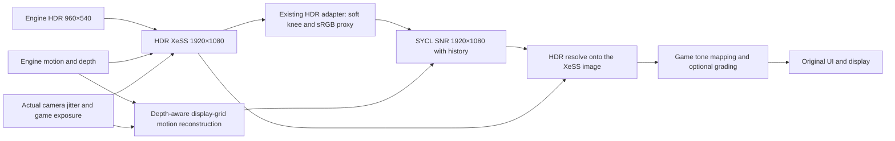
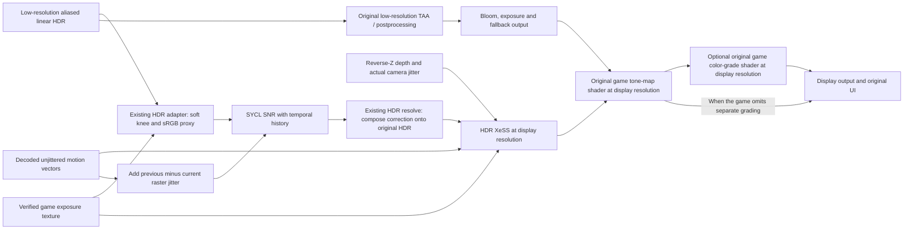
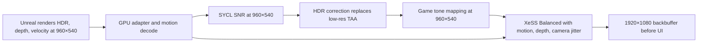

# Tekken 7: SNR → XeSS experiment

The current implementation runs XeSS and SNR before the game's tone mapping.
Earlier LDR work is retained at the end as investigation history.

## XeSS before SNR (2026-10-28)

The requested alternative order is selected at process startup by
`OptiScaler.xess-snr.enable`, in addition to the existing native/HDR markers.
Without this marker the previous SNR → XeSS order remains available. Restart
the game when changing order. Both paths retain original low-resolution game
postprocessing as a fallback and replay verified tone mapping / optional grading
at display resolution before the original UI.

XeSS's public execution API returns color, not motion or depth. The reusable
`NrDisplayMotionDx11::Reconstructor` consumes decoded current-to-previous
render-pixel velocity and depth. For display pixel center `p`, it samples the
current render grid at `p * inputSize / outputSize + rasterJitter`. A 2×2 gather
selects the nearest-depth surface (largest depth for reverse Z), breaking equal
depth ties by distance. It never blends velocities across foreground/background
boundaries. Selected displacement is multiplied by `outputSize / inputSize`.
There is no previous-minus-current jitter term: both SNR input and its history
now live on the unjittered XeSS output grid. Invalid motion/depth produces an
out-of-frame history coordinate, which the existing SNR confidence pass rejects.

This reconstructs an approximate motion field from engine data; it does not
recover XeSS's private internal field or add geometric information at newly
reconstructed edges. Temporal artifact checks remain necessary. The GPU smoke
test checks displacement units/sign, nonuniform scale, jitter sampling, depth
edges in both Z conventions, stationary scenes, invalid inputs, caching and
resize/reset on Arc with D3D11 debug validation.

`ValheimNr_Dx11::ProcessWithMotion` provides the same GPU interop to either
ordering. SNR's HDR adapter and composition are unchanged. The post-XeSS path
clears only its isolated D3D11 state after XeSS before reading that output;
normal D3D11 ordering and the existing D3D11/D3D12/SYCL bridge synchronize the
resources. No production pixel readback is added. Both histories reset on model
toggle, input/display resize or a missed final output. Diagnostic capture adds
`neural-input` so SNR's input can be compared directly with XeSS output.

Installed candidate SHA-256:
`3C04E8DBD2C720692ACFA7D58B66E3C81BC3E5E23DBADE8D756FEB73C59A00F4`.
Previous DLL and configuration are preserved under
`tekken-snr-xess-live/xess-before-snr-20261028/`. Input remains 960×540 and display
1920×1080; the model now has four times as many pixels. Live timing and quality
validation of this order are in progress.

## HDR integration and live validation (2026-10-28)

**The preceding test build ran SNR → XeSS before tone mapping at
960×540 → 1920×1080. The startup stall is fixed. Face softness remains a
reported quality issue; completion of an API call is not a quality verdict.**
The live A/B run captured an actual demo fight with SNR on, XeSS only, and SNR
on again, including the final presented backbuffer and sixteen consecutive
displayed frames in each mode. All three captures matched the actual backbuffer.

Previous DLL SHA-256 (character-output fix, 16:18):
`72593B9829C2654BBD4807CCF1B5D15BCBD0AB2791BDB12A8298ED10AAED0234`.
The live A/B evidence described above was captured with the preceding build
`8B76FC9FA7BA6CF8D0A787E40439450629700EC20AF69007C1ECFA8D06D62658`,
preserved as `character-20261028/fixed/dxgi-before.dll`. The user confirmed that
the fixed character screen worked in the 16:20–16:23 run. Its log reached output
frame 4680, with temporal history active and no error-level entries. The final
60 warmed SNR samples had medians of 23.665 ms model / 24.625 ms provider at
960×540. Missed-upscale warnings were confined to the earlier startup interval;
the later scene used history normally. No new pixel capture was taken during
that user-controlled run, so this is user confirmation plus log evidence.
The previous fallback DLL is preserved outside the game as
`hdr-adapter-20261028/dxgi-before.dll`, SHA-256
`F2E1EEBF376D80D41BB47BEA9066E3703BBEF65FEF28F7CF8F805F437722E611`.

A subsequent change supports other input resolutions using the runtime's
`xessGetOptimalInputResolution` ranges. Its GPU postprocess tests pass at 1x,
1.5x, and 2x. This is included in the installed character-output fix, but the
game's `r.ScreenPercentage=50` setting is unchanged. Do not describe
1280×720 → 1920×1080 as live-validated yet.

An additional `OptiScaler.snr-xess.hdr.enable` marker selects this path:

The HDR XeSS context uses reverse depth and the game's exposure, without the
LDR or autoexposure flags. The recognized tone-map vertex shader
`fa1f4bec42d7668a` (1388 bytes) passes VS t0[0,0].r directly to the pixel shader's
exposure input. `NrHdrAdapterDx11::Exposure` converts that scalar to a 1×1
R32_FLOAT texture on the GPU for both consumers. Captured battle exposure was 1;
this does not justify assuming exposure is always 1.

Out-of-range or non-finite camera jitter rejects the HDR path rather than
clamping it. XeSS receives unjittered current-to-previous pixel motion and the
actual raster jitter, with Y negated to match Intel's D3D11 sample. SNR has a
separate motion texture containing the previous-minus-current raster-jitter
correction, because its history image is jittered. A missing displayed frame or
model toggle invalidates temporal history.

Tone mapping and grading replay the original game shaders, LUTs, exposure
constants and bindings. Their render targets and screen-space View constants
use the actual display/input scale; constant-buffer patches run on the GPU. The
low-resolution game draws still execute for bloom/exposure and safe fallback.
The final spatial pass is replaced only when its source is the exact same-frame
output of the last replayed pass. Tone mapping is required; separate color
grading is optional when the game routes tone-map output straight into the
final spatial pass. Unknown resource chains retain the game output and reset
temporal history. This is a guarded Tekken shader adapter, not a universal
Unreal Engine integration.

The character-customization capture at 16:10:56 exposed a missing variant:
draw 380 was TAA, draw 420 tone mapping, and draw 425 final upscale, with no
separate color-grade draw. The tone-map target and upscale source were the same
resource. Requiring two replays discarded SNR/XeSS output and reset history
every frame, despite the GPU executing the model. `Bridge::FinalColor` now
accepts either verified chain length and still requires exact resource identity.
The regression test failed on the old code (`tone-only frame missing`) and
passed on Arc after the fix, including switching between graded and ungraded
frames. The fix was installed with matching source/installed SHA-256 hashes;
live customization verification was subsequently confirmed by the user and log.

The adapter currently recognizes tone-map bytecode FNV64 `ae69caf5eb29a60b`
(1932 bytes) and color-grade `260885badbf2631a` (2736 bytes). Their pixel-shader
View registers are respectively b1 and b0. View rows 114 and 115 hold the rect
origin and size/inverse size; grading also uses row 116 for buffer dimensions.
Other constants are copied bit for bit. Unknown shader variants are not replayed.
Shader roles are attached to each shader object with private data; duplicate
objects do not invalidate recognition. A display-sized scissor on a smaller
viewport is valid: replay scales its intersection with that viewport and then
restores the original rectangle.

### Existing HDR adapter

`NrHdrAdapter_Dx11` compiles the existing
`shaders/dlssnr/precompile/dlssnr.hlsl` for D3D11 SM5.0. It does not invent a
second color transform and does not use the former `sqrt(saturate(HDR))` proxy
or additive residual. The original HDR and alpha are retained; model output is
resolved with the existing composition. `ColourStrength=0` preserves the
original HDR chromaticity while allowing neural luminance changes.
`TransferStrength=0` and adapter bypass reproduce the original HDR exactly.

`ValheimNr_Dx11::ProcessBeforeXeSS(..., external_hdr_composition=true)` requests
the raw model correction from the provider. Transfer and color strength are
applied once by the HDR adapter, rather than once in the provider and again in
HDR resolve. The SNR DLL, weights, and approximation settings were not changed
by this integration work. FP16 HDR storage alone does not make this model
HDR-trained; the adapter is still required.

### Stall isolation

The original black-screen stall was reproducible at the second Present even
with only input preparation enabled and XeSS initialization disabled. XeSS
initialization/context allocation alone did not stall. Adding Flush while
retaining a full context-state swap did not fix it. Keeping the game's graphics
context active for input preparation, and restoring only the CS bindings touched
by that preparation, removed the stall. XeSS initialization/execution and private
constant-buffer work retain their own context-state isolation.

This is a controlled integration fix, not proof of an Intel driver defect.
Subsequent runs passed thousands of Presents and completed demo fights. The
separate feature-level probe reported `0xb000` before XeSS context creation,
after creation, and after initialization: D3D11 11_0 was preserved.

### Validation and remaining quality work

`tests/tekken-hdr-postprocess/smoke.vcxproj` runs on the Intel Arc D3D11 11_0
device with the debug layer. It validates promoted pixels, all patched/untouched
constant values, resource and binding restoration, same-frame resource pairing,
rejection of out-of-order passes, reset, resize, large scissors, and 1x/1.5x/2x
scales, tone-only output pixels, and switching between one- and two-pass chains.
`tests/nr-hdr-adapter` checks the shader against an independent CPU
sRGB/soft-knee reference, exact bypass, neutral-model reconstruction, live GPU
exposure, hue and alpha. `tests/tekken-temporal-inputs` checks captured HDR and
depth exactly, decoded motion within FP16 tolerance, and separate SNR/XeSS jitter
semantics. All passed. Adapter/postprocess debug-layer runs were clean.

The separate captured-input XeSS reproducer also completed 48 queued HDR
executions at D3D11 feature level 11_0, with GPU producer copies, context-state
swaps and repeated history resets. That narrower test did not reproduce the
game's stall. Its timings are diagnostic, not a game performance result.

Live evidence is in the task's `tekken-snr-xess-live/hdr-adapter-20261028/`,
particularly `battle-qa-154912/{snr-on,xess-only,snr-on-again}` and `complete.log`.
Each directory contains source HDR, decoded motion/depth, actual exposure,
XeSS/postprocess output and Present (proxy/neural/resolved only when SNR ran),
plus `metrics.json`, PNGs and a slowed sixteen-frame `motion.webp`. Those sequences
use explicit synchronous diagnostic readback and must not be used for timing.
Normal rendering does not stage images through CPU memory.

In the two battle captures, SNR changed mean HDR chromaticity by about 0.004%
with ColourStrength=0. Luminance changed substantially: median ratios were
1.068 and 1.021, with the configured ratio limit reached in some pixels. Thus
"colors are preserved" does not mean identical lighting, or prove stable shadows.
XeSS-only versus the same-frame game TAA/postprocess result had mean RGB changes
of approximately +0.33%, +0.13%, +0.10% of normalized signal. These different
reconstruction methods are not expected to be pixel-identical.

Outside capture overhead, the warmed 960×540 model took approximately 23.6 ms,
provider 24.6 ms, and displayed-frame cadence was roughly 30–31 ms (32–33 FPS).
This is not a 720p model timing. The first model invocation took about 535 ms.

The user observed soft faces in the 540p result. A 720p candidate has been built
to compare additional source detail and performance. The installed XeSS runtime
reports 1280×720 as Ultra Quality's optimal input for 1080p. Mip bias must be
based on the actual input/output ratio, not a hardcoded preset name. Do not
change the user's active game installation while they are testing. The short
four-sample camera jitter sequence, mip selection, difficult disocclusions,
scene cuts and face detail still need broader quality validation.

Reference: [Intel XeSS-SR developer guide](https://github.com/intel/xess/blob/main/doc/xess_sr_developer_guide_english.md),
[Intel D3D11 sample](https://github.com/intel/xess/blob/main/samples/basic_sample_super_resolution_dx11/basic_sample_d3d11.cpp).

## Earlier LDR implementation (superseded)

This is an opt-in D3D11 experiment for Tekken 7. The game's TAA and final
spatial-upscale pixel shaders are identified by their bytecode hashes. Other
games continue through the existing OptiScaler paths. A failed or unsupported
pass executes the game's original draw.

The native adapter takes each low-resolution HDR and depth pixel directly,
decodes Tekken's packed object motion or camera reprojection, and converts
displacement to input-resolution pixels. The SNR proxy is
`sqrt(saturate(HDR))`. Composition keeps the game's HDR content and applies
the model's change in proxy space. When neural rendering is disabled, the
game's own TAA and spatial upscale run unchanged. With NR enabled and
`Apply the model` off, the adapter copies raw HDR through the TAA target and
XeSS runs without SNR; this isolates XeSS quality in a live A/B. The final-upscale hook
converts post-tonemap BGRA8 to RGBA16F and runs XeSS at 2x only after SNR.
UI draws happen after this pass.

The jitter is copied from the D3D11 constant buffer that the game updates on
the CPU. A `Map`/`Unmap` hook captures it without GPU readback. The captured
16-frame sequence confirmed that `View[133].zw` matches the projection-matrix
jitter to within 3e-8 pixels. The hook accepts Unreal's 4/8/16/32/64 sample
counts and validates each sample index against its sequence length. XeSS's
D3D11 Y jitter has the opposite sign from Tekken's stored raster-space Y,
following Intel's D3D11 sample. Tekken's default eight-position pattern has
two positions outside XeSS's +/-0.5-pixel range, so that default remains an
approximation because those XeSS values are clamped.

For external motion vectors, SNR compares the current proxy with a reprojected
copy of the previous proxy. Mismatched or out-of-frame history is suppressed
before the model and the temporal blend, reducing trails from disocclusion and
moving lighting. The comparison stays on the Intel GPU.

The production path uses D3D11 textures and D3D11/D3D12 shared resources;
it has no CPU pixel readback. It saves and restores the game's D3D11 state
through an 11_0 context state. The diagnostic frame capture and the smoke
test do use CPU staging, but neither is part of the production frame path.

To enable the native experiment, set `r.ScreenPercentage=50` in Tekken's
`Engine.ini` and place both `OptiScaler.snr-xess.enable` and
`OptiScaler.snr-xess.native.enable` beside the game `dxgi.dll` before launch.
The XeSS D3D11 runtime must be available beside the game. Without the native
marker, the older downsampled experiment remains active. Set
`r.TemporalAASamples=4` in `Engine.ini` for the tested XeSS sequence: the
captured four positions are `(0.375,-0.125)`, `(0.125,0.375)`,
`(-0.375,0.125)`, and `(-0.125,-0.375)` pixels, all within XeSS's input range.
This is a compatibility choice, not an image-quality optimum: XeSS recommends
a longer jitter sequence for 2x upscaling. Tekken's 32-position pattern was
also tested, but a 16-frame capture already reached -0.660 and +0.541 pixels
on X, so it still requires clamping and was not retained.

The captured-frame GPU test is in `tests/tekken-temporal-inputs`. Build its
`smoke.vcxproj` and pass the directory containing captured TAA inputs and
`balanced-*` reference files, followed by `native`. It checks HDR, SNR proxy,
decoded motion, and depth against the independent CPU reference. The fixture
is large and remains outside Git.

**Known quality limitation:** XeSS runs after Tekken's tone mapping in this
hook. Intel describes post-tonemap XeSS as experimental and does not guarantee
quality. The available low-resolution TAA output and final spatial-upscale
input are separated by game postprocessing; replacing that entire chain at
display resolution would require engine integration. The old adapter averaged
a 1920×1080 frame to 960×540, which caused visible blur; it remains only for
comparison. The one-frame offline XeSS test proves format compatibility and
~3.1 ms GPU execution on Arc Pro B70, not temporal image quality. The native
path failed the 2026-10-28 live video comparison: the user saw shaking and
dark colors. The stable 1920×1080 SNR path was restored for reference videos;
the native experiment was then re-enabled for automated demo testing.

The adapter rejects unexpected color, depth, velocity, or constant-buffer
layouts before dispatch. It pairs TAA and final upscale inside one Present
interval and resets temporal history when that pair is broken. The
captured-frame GPU smoke test validates HDR, SNR proxy, decoded motion, and
depth against an independent CPU reference; it also rejects a malformed
constant buffer. That test validates one frame's layout and conversion, not
temporal alignment during motion.

The 2026-10-28 automated demo-battle test with four TAA samples ran native
SNR→XeSS with no missing or clamped jitter and no OptiScaler errors. At
960×540, the SYCL model took about 23.6 ms and the provider about 24.6 ms.
This confirms input availability and timing, not image quality. The game
chooses different fighters and stages on each run, so stills from separate
runs are not pixel-matched. A later continuous recording toggled only the SNR
model during one demo fight: the scene became slightly lighter without SNR,
while XeSS-only remained soft. A second continuous recording toggled an
experimental sRGB decode/encode around XeSS; it showed no convincing quality
improvement, so the tested game DLL was restored and that experiment was
removed from the source. These captures suggest that model composition
contributes to darkening. They do not isolate the cause of softness or establish
temporal quality under all scenes. The final color available to the old hook is
after tone mapping, whereas XeSS recommends HDR input before tone mapping.
