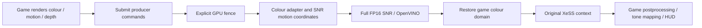

# SNR → native XeSS integration work (2026-11-05)

## Current status

`[DlssNr] NativeXeSS=true` enables a **native D3D12 XeSS baseline and command-boundary probe**.
It does not yet insert SNR. `XESS-NATIVE ... snr=false` in the log is intentional.
The old generic NGX translation remains the default when the option is false.

The current test target is The Witcher 3 DX12 on Intel Arc Pro B70.
Game XeSS libraries are preserved. Only `dxgi.dll` and `OptiScaler.ini` were added.
SNR remains off until the explicit cross-API submission boundary is implemented and tested.
There is no claim of validated Witcher SNR image quality or performance yet.

## Why the native context path exists

The common NGX translation fabricates XeSS properties and resolution answers, does
not retain all exposure modes, and can remap presets. The native path calls the
game's real SDK context through the existing Detours trampolines. It forwards
SDK queries, legacy scale selection, initialization, exposure multiplier, velocity
scale, jitter scale, network choice, dumps, profiling, execution, and destruction.
Execute parameters and the original resource pointers are passed unchanged.
The undocumented context-parameter entry point is left unhooked in native mode.

Intel specifies querying the SDK for resolution, preserving colour/exposure
semantics, and submitting the commands recorded by XeSS through the application
queue. See the [XeSS developer guide](https://github.com/intel/xess/blob/main/doc/xess_sr_developer_guide_english.md).

## Implementation

- `OptiScaler/inputs/XeSS_Native_Dx12.{h,cpp}`: real context lifecycle, native execute,
  resource/parameter logging, and transparent tail-command counters.
- `inputs/XeSS_Common.cpp`, `XeSS_Dx12.cpp`, `XeSS_Dbg.cpp`: route native handles to
  the original SDK; other API contexts keep their existing path.
- `proxies/XeSS_Proxy.h`: access to the game's original SDK trampolines.
- `tests/xess-native-dx12`: standalone B70 GPU A/B integration test.

The probe counts draw, dispatch, copy, indirect and legacy barrier calls after
XeSS returns and before Close. A nonzero count establishes that deferred execution
after that list would be unsafe. Zero counters do **not** prove a universally safe
boundary: bundles, enhanced barriers, other interfaces and hidden consumers must
also be accounted for. This is diagnostic observation, not an ordering mechanism.

## Required production ordering

SNR must consume the current frame, with a separate history per context and
resolution. XeSS keeps the game's original motion/depth/jitter/exposure contract.
The model must not be fed raw HDR as if it were display RGB. The adapter's bypass,
neutral response, saturated colours, highlights and temporal exposure changes need
independent image tests. The model graph and weights are not changed by this work.

OpenVINO's current external GPU-buffer provider needs submitted D3D12 work before
inference. The existing `NativeAfterSubmit` path runs after an upscaler producer
list; it is not a pre-XeSS solution. If Witcher records consumers in the same list,
a correctly state-preserving command-list split/continuation is required.
Waiting inside an unsubmitted game list or overwriting already-consumed output
would be incorrect. Production image data must stay on the GPU.

## Validation completed

The proxy compiled successfully with MSVC x64 Release. On B70, original game XeSS
versus the proxy produced bit-identical output for 12 frames per path in each of
four modes: scalar exposure, exposure texture, autoexposure and LDR. Tests include
nonzero texture bases, jitter/velocity scales, an exposure multiplier, history
resets, seven quality queries and legacy scale selection. All SDK query responses
also matched. This validates the native XeSS baseline, not SNR composition.

Run `tests/xess-native-dx12/run.ps1` with explicit `-XeSSDll`, `-OptiScalerDll` and
`-WorkDirectory` paths. Results include hashes, pixel dumps and logs. Use a separate
work directory on the data drive; do not put test outputs in a game directory.
